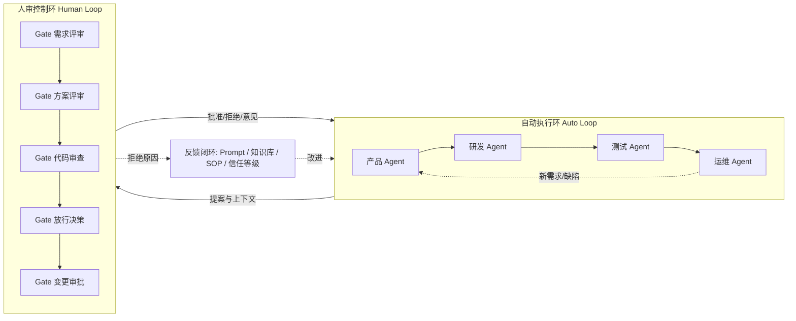
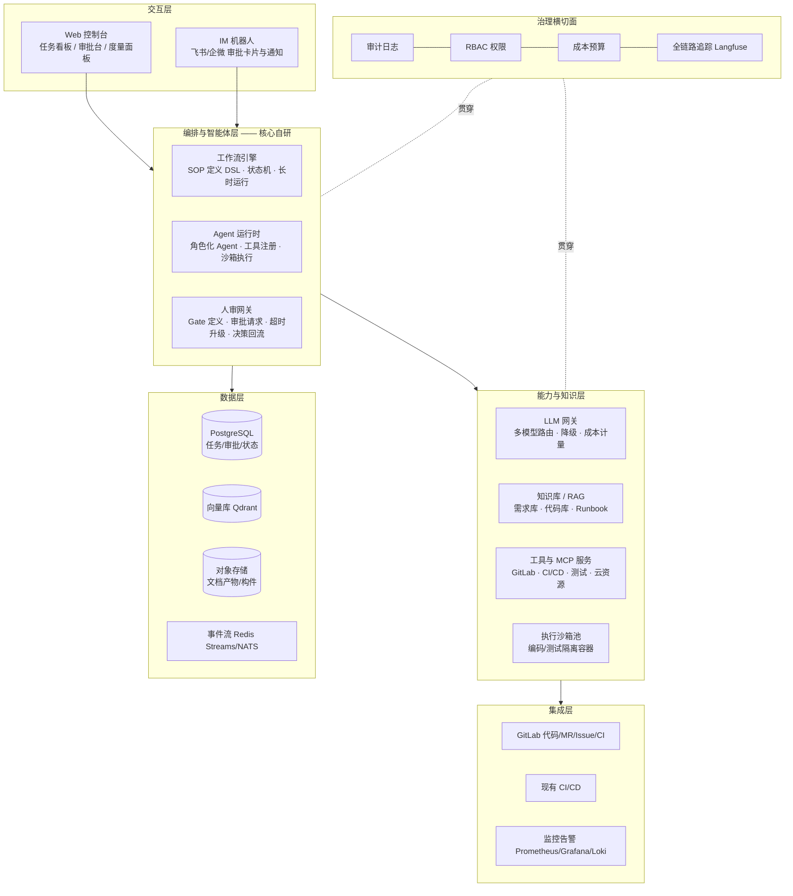
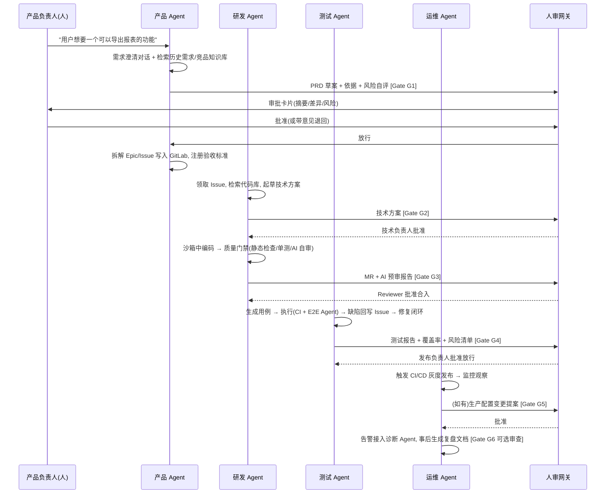

# 01 · 总体设计与架构

## 1. 愿景与关键转变

**愿景**：把"产品 → 研发 → 测试 → 运维"的整条 SOP 变成一条 AI 自动化生产线。AI Agent 完成绝大部分执行性工作，人只出现在两类位置——**决策点**（方向、取舍、放行）与**审查点**（质量把关），并且人的每一次干预都反向训练这条生产线。

**关键转变**：

| 传统模式 | 目标模式 |
|---|---|
| 人使用工具，流程约束人 | Agent 使用工具，流程约束 Agent，人约束流程 |
| 人写 PRD/代码/用例/变更单 | AI 起草与执行，人批准与审查 |
| 质量靠人自觉 + 抽查 | 质量门禁自动化、常态化、可度量 |
| 流程靠文档与会议 | SOP 即代码，可版本化、可回放、可优化 |

## 2. 核心模型：双环 + 反馈闭环

- **自动执行环**：Agent 在工作流引擎上按 SOP 状态机推进，长任务（编码、测试、部署）由持久化工作流托管，不因进程重启而丢失。
- **人审控制环**：Gate 是流程的一等公民。Agent 到达 Gate 必须**暂停**，携带"做了什么 / 依据是什么 / 风险自评"三要素上下文等待人审。
- **反馈闭环**：人审的"拒绝 + 原因"被结构化沉淀，定期复盘后落到三类改进：Agent 的 Prompt 与规则、知识库内容、SOP 中 Gate 的位置与力度。

## 3. 角色重定义

| 环节 | 传统：人做 | 目标：AI 做 | 人保留什么 |
|---|---|---|---|
| 产品 | 写 PRD、拆需求、跟进澄清 | 需求结构化、检索背景、起草 PRD、拆解 Issue、澄清答疑 | **拍板 PRD**（G1）、需求优先级与取舍 |
| 研发 | 写方案、编码、自测、改 bug | 起草技术方案、在沙箱中编码、自测、AI 预审 MR、修复缺陷 | **方案评审**（G2）、**MR 审查**（G3） |
| 测试 | 写用例、执行、写报告 | 生成用例、执行单元/接口/E2E、生成报告、缺陷回归 | **放行决策**（G4）、疑难问题复验 |
| 运维 | 处理告警、发变更、写复盘 | 诊断告警、执行安全动作、起草变更单与复盘 | **生产变更审批**（G5）、复盘审查 |

**原则**：人在价值链上的位置整体上移——从"执行者"变成"决策者 + 审查者"；所有重复性、检索性、格式性、回归性工作全部下沉给 Agent。

## 4. 总体架构

### 分层职责

1. **交互层**：Web 控制台是"生产线总控室"（任务看板、审批台、度量面板）；IM 机器人是高频审批入口——人审 Gate 以交互卡片形式推到手机，一键批准/拒绝/退回。
2. **编排与智能体层（自研核心）**：
   - 工作流引擎承载 SOP 定义（DSL：步骤、Gate、条件、超时、升级策略），任务状态持久化；
   - Agent 运行时按"角色"实例化 Agent，绑定工具集与权限边界；
   - 人审网关统一管理所有 Gate：生成审批请求（带上下文快照）、分发到 Web/IM、处理超时升级、把决策结果回写流程并回流反馈。
3. **能力与知识层**：LLM 网关屏蔽模型供应商差异（多模型路由、降级、成本计量）；RAG 让 Agent 每次行动都有据可依；工具与 MCP 服务是 Agent 的"手"；沙箱池保证不受信代码在隔离环境运行。
4. **集成层**：**接入而非替代**——GitLab 是代码、MR、Issue、CI 的事实源，平台通过 API/Webhook 与其双向同步；现有 CI/CD 继续承担构建发布，平台只负责触发、等待与解读结果。
5. **数据层**：PostgreSQL 存所有业务状态；向量库存知识；对象存储存 PRD、方案、报告等版本化产物；事件流解耦各组件。
6. **治理横切面**：所有 AI 动作、所有人审决策全程留痕；按角色授权；LLM 成本按流程/项目计量并设预算；Langfuse 做全链路追踪与评估。

## 5. 一次典型流转（端到端）

从一条模糊想法到上线，生产线如何运转：

全流程 **6 个人审 Gate（可裁剪）**，其余步骤全部由 Agent 完成。Gate 的定义、上下文要求与信任分级见 `02` 与 `03`。

## 6. 关键架构决策（ADR 摘要）

| # | 决策点 | 选择 | 理由 | 备选 |
|---|---|---|---|---|
| 1 | 工作流引擎 | MVP 用 n8n/Windmill，演进到 Temporal | 快速组装验证流程；Temporal 提供持久化执行与原生人审信号，适合长时生产线 | Airflow/Dagster |
| 2 | Agent 框架 | LangGraph | 状态图建模 + checkpoint 持久化 + interrupt 天然支持人审挂起 | Dify、自研 |
| 3 | 编码执行 | 无头 Claude Code SDK / Aider（容器内） | 与 GitLab MR 流程契合、可脚本化、质量成熟 | OpenHands、自研编码 Agent |
| 4 | LLM 接入 | LiteLLM 网关 | 多供应商统一、路由降级、成本计量，避免供应商锁定 | 直连单一 API |
| 5 | 知识库 | RAGFlow + Qdrant | 解析/分块/检索开箱即用，支持代码与文档混合 | LangChain 自拼 |
| 6 | 可观测 | Langfuse | Trace/Eval/成本一体，Agent 级观测 | 自建 |
| 7 | 人审网关 | 自研轻量服务 + IM 交互卡片 | 这是平台差异化核心，必须完全可控；技术上简单（审批状态机） | 采购 OA/BPM |
| 8 | 任务事实源 | GitLab Issue + MR | 复用现有工具链，研发无需迁移 | 自建任务系统 |

> 详细选型对比、部署拓扑与成本估算见 [04-技术选型与组件清单](04-技术选型与组件清单.md)。
