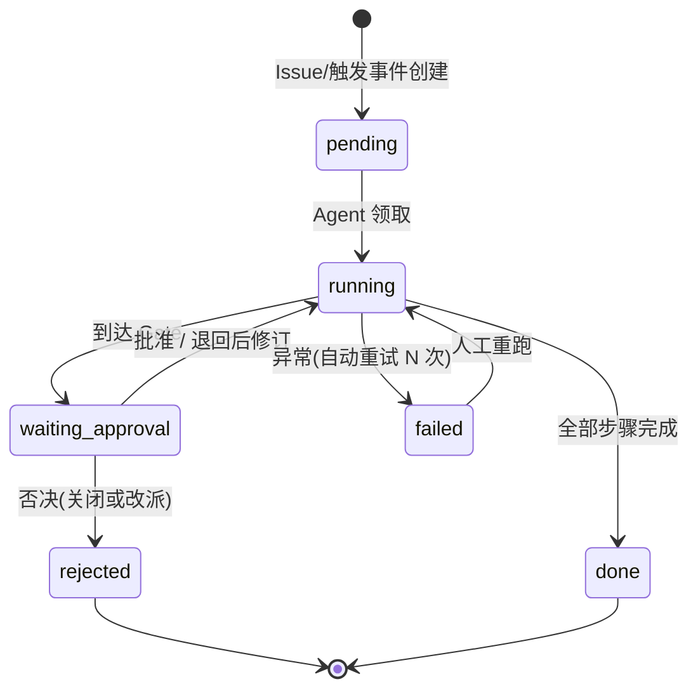
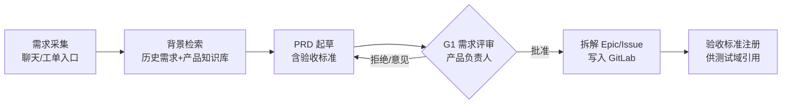
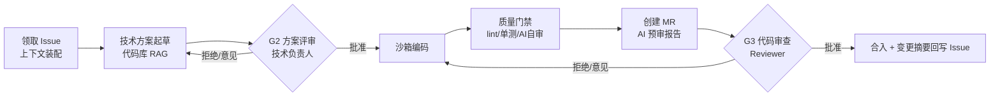
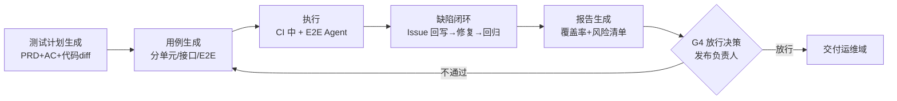
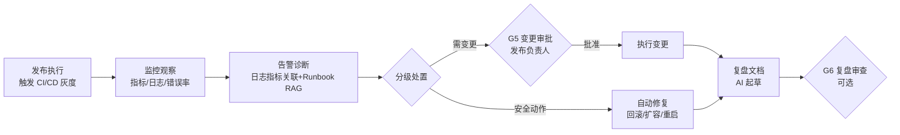

# 02 · 核心 SOP 流程设计

> 每个域给出一条可执行的 SOP 流水线：AI 步骤（A）、人审 Gate（G）、输入/输出物（Artifact）、质量门禁（QG）。GitLab Issue 是全流程任务的唯一事实源。

## 0. 通用任务状态机

所有域的任务共享同一状态机（在工作流引擎中实现）：

通用规则：

- **超时升级**：Gate 超过 SLA（默认 24h，可配置）未处理 → 提醒审批人 → 升级到其上级/值班人；可配置"超时默认拒绝"或"超时自动放行"（仅限 L1 级，见 `03`）。
- **可重试可回滚**：每个 AI 步骤必须幂等或可重放；失败自动重试 3 次后转人工。
- **上下文快照**：到达 Gate 时冻结当时的输入物、产物、依据链接，审批人看到的永远是一致快照，不随流程继续而漂移。

## 1. 产品域 SOP：从想法到可执行需求

| 步骤 | 类型 | 说明 |
|---|---|---|
| A1 需求采集 | AI | 多轮澄清对话把模糊想法结构化：背景、目标、用户、场景、非目标、约束。 |
| A2 背景检索 | AI | RAG 检索历史 PRD、竞品资料、产品知识库，输出"相似需求与差异点"。 |
| A3 PRD 起草 | AI | 生成 PRD：用户故事、EARS 式验收标准、影响面初判；标注每条依据的来源链接。 |
| **G1 需求评审** | **人** | **决策者：产品负责人**。看：目标是否成立、范围是否合理、验收标准是否可测。否决需给原因，退回自动修订。 |
| A4 拆解 | AI | Epic → Issue（技术拆解交给研发域，此处只做业务拆解），写入 GitLab 并关联。 |
| A5 注册 | AI | 验收标准以结构化字段写入 Issue 描述/自定义字段，测试域直接消费。 |

**产物**：PRD（版本化入库）、GitLab Epic/Issue、验收标准（结构化）。

## 2. 研发域 SOP：从 Issue 到合入的 MR

| 步骤 | 类型 | 说明 |
|---|---|---|
| B1 上下文装配 | AI | 拉取 Issue + 关联 PRD/验收标准 + 相关代码文件（RAG），形成"任务卡片"。 |
| B2 方案起草 | AI | 输出技术方案：改动模块、接口变化、数据/迁移、风险与回滚策略；引用具体代码位置。 |
| **G2 方案评审** | **人** | **决策者：技术负责人/架构师**。看：方案合理性、影响面、是否有更简方案。小改动（<100 行预期）可配置跳过。 |
| B3 编码 | AI | 编码 Agent 在**沙箱容器**中实现；允许多轮自迭代（跑测试→修复），迭代轮数有上限。 |
| B4 质量门禁 | 自动 | 硬门禁：lint 通过、单测通过、覆盖率不降、依赖漏洞扫描、AI 自审（对照验收标准逐条核对并给出证据）。任一失败自动重试修复，仍失败则 MR 标记"需人介入"。 |
| B5 创建 MR | AI | 提交 MR，附：变更摘要、逐条验收标准核对表、自测证据、风险点。 |
| **G3 代码审查** | **人** | **审查者：Reviewer（研发同事/负责人）**。AI 已完成预审并把"建议关注点"标出；人做终审与 Approve。 |
| B6 合入 | AI | 合入后：更新 Issue 状态、把变更摘要与关键决策回写知识库。 |

**质量门禁分级**：

| 门禁 | 级别 | 失败处理 |
|---|---|---|
| lint / 类型检查 | 硬 | 自动修复重试 → 转人 |
| 单元测试 | 硬 | 同上 |
| 覆盖率不降 | 硬（可配置豁免） | MR 阻断 |
| 依赖漏洞扫描 | 硬 | MR 阻断 |
| AI 验收标准自审 | 软（进人审上下文） | 附在 MR 里供 Reviewer 参考 |
| 性能/安全扫描 | 硬（发布前） | 见运维域 |

## 3. 测试域 SOP：从验收标准到放行报告

| 步骤 | 类型 | 说明 |
|---|---|---|
| C1 测试计划 | AI | 依据 PRD 验收标准 + 代码 diff 生成测试策略：范围、分层、环境需求。 |
| C2 用例生成 | AI | 单元（补边角）、接口（契约）、E2E（用户路径，Playwright）；人工可增删（L1 级，事后可审计）。 |
| C3 执行 | AI | 单元/接口在 CI 中执行；E2E 由测试 Agent 驱动浏览器执行，失败自动截图/录屏留证并做初步归因。 |
| C4 缺陷闭环 | AI | 缺陷写回 GitLab Issue（关联用例与复现步骤）→ 研发 Agent 修复 → 自动回归，直到关闭；反复打回的缺陷升级人审。 |
| C5 报告 | AI | 汇总：覆盖矩阵、失败与风险清单、与上一版本对比、未决问题。 |
| **G4 放行决策** | **人** | **决策者：测试/发布负责人**。看：覆盖率是否达标、风险清单是否可接受、是否有未决缺陷。 |

## 4. 运维域 SOP：从发布到稳态

| 步骤 | 类型 | 说明 |
|---|---|---|
| D1 发布执行 | AI | 编排 CI/CD：构建 → 部署灰度（如 5%→30%→100%）→ 每档观察期自动判断继续/暂停。 |
| D2 监控观察 | AI | 拉取黄金指标（错误率、延迟、饱和度）与日志，异常即进入 D3。 |
| D3 告警诊断 | AI | 关联日志（Loki）+ 指标（Prometheus）+ Runbook RAG，输出诊断报告与处置建议。 |
| D4 分级处置 | 自动 | 白名单安全动作（回滚、重启无状态服务、水平扩容）直接执行并通知；其余动作生成变更提案 → G5。 |
| **G5 变更审批** | **人** | **决策者：发布/运维负责人**。看：变更内容、影响面、回滚方案、风险自评。生产变更默认 L3 强制审批。 |
| D6 执行变更 | AI | 审批后执行，执行过程可观测、可中断。 |
| D7 复盘 | AI | 起草故障复盘：时间线、根因、影响、改进项（关联 Issue）。 |
| **G6 复盘审查** | **人（可选）** | 事故级复盘必审；普通告警复盘抽查。 |

## 5. 横切机制

### 5.1 缺陷与变更的唯一事实源

- 一切任务 = GitLab Issue（自定义字段承载：验收标准、风险分、Gate 状态、Agent 身份）。
- 一切代码变更 = MR（AI 署名 + 预审报告 + 人审记录）。
- 文档产物（PRD/方案/报告/复盘）版本化存对象存储，与 Issue/MR 双向链接。

### 5.2 变更管理

- 任何"改生产环境"的动作必须走变更提案：内容、影响、回滚、风险分。
- 变更提案可由 AI 起草，人只填"批准"或"拒绝理由"。

### 5.3 全流程可追踪

- 每个 Issue 有完整时间线：谁（哪个 Agent/人）在何时做了什么、依据是什么、Gate 决策是什么。
- 度量面板按 Issue/迭代/人效聚合，见 `05`。

## 6. Gate 总览（默认配置，可按团队裁剪）

| Gate | 位置 | 决策/审查者 | 默认信任级 | 可裁剪性 |
|---|---|---|---|---|
| G1 需求评审 | 产品域 | 产品负责人 | L2 提案+审批 | 小需求可降为 L1 |
| G2 方案评审 | 研发域 | 技术负责人 | L2 | 小改动可跳过 |
| G3 代码审查 | 研发域 | Reviewer | L2 | 高信任 Agent 降为抽查 |
| G4 放行决策 | 测试域 | 发布负责人 | L3 强制 | 补丁级可降级 |
| G5 变更审批 | 运维域 | 发布负责人 | L3 强制 | 不可跳过 |
| G6 复盘审查 | 运维域 | 技术负责人 | 事故必审/常规抽查 | 按事件等级 |

> 信任分级（L1 全自动 / L2 提案审批 / L3 强制审批）的完整定义、升降级规则与审批网关设计见 [03-人机协作与治理](03-人机协作与治理.md)。
