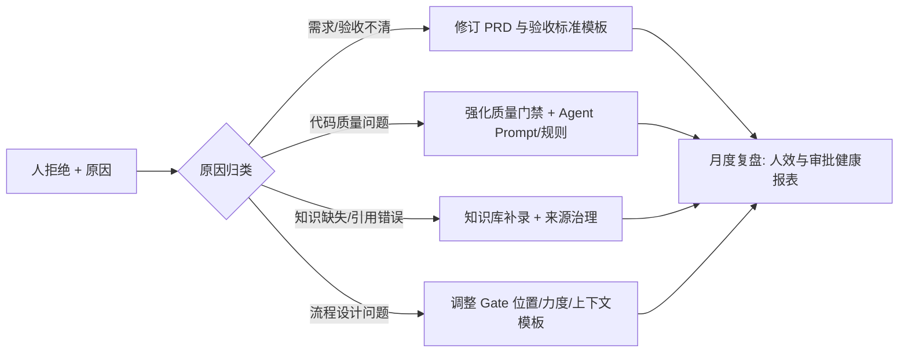

# 03 · 人机协作与治理

> 本平台与一般 AI 编码工具的本质差异：**人审是流程的一等公民**。这一章定义人在哪里、怎么把关、把关结果如何回流。

## 1. 角色模型

### 1.1 人的三种身份

| 身份 | 职责 | 典型人物 |
|---|---|---|
| **决策者 Approver** | 在 Gate 上批准 / 拒绝 / 带意见退回；对方向与放行负责 | 产品负责人、技术负责人、发布负责人 |
| **审查者 Reviewer** | 对产物做质量终审（代码、报告、复盘） | 研发同事、测试负责人 |
| **监督者 Observer** | 订阅通知、事后审计、抽查 | 全员、质量小组 |

**关键设计**：决策者"看上下文、不做执行"，审查者"审差异、不重写"。人审的输入永远是 Agent 准备好的"三要素上下文"（见 2.3），把人的认知负担降到最低。

### 1.2 AI 的四种执行角色

每个域 Agent 是一张"角色卡"：目标、工具集、权限边界、约束规则。

| Agent | 目标 | 关键工具 | 权限边界 |
|---|---|---|---|
| 产品 Agent | 需求→可执行 Issue | 知识库检索、GitLab Issue、文档产物库 | 只写 Issue/文档，不可改代码 |
| 研发 Agent | Issue→合入 MR | 代码检索、沙箱编辑、测试执行、GitLab MR | 只能改自己任务分支；无生产权限 |
| 测试 Agent | 验收标准→放行报告 | 测试框架、Playwright、CI 结果、缺陷回写 | 只读代码，写测试产物与 Issue |
| 运维 Agent | 稳态→可观测发布 | 监控/日志查询、CI/CD 触发、白名单动作 | 默认只读；写操作走变更审批 |

## 2. 信任分级：风险决定人的参与度

### 2.1 三级信任

| 级别 | 模式 | 人参与方式 | 典型场景 |
|---|---|---|---|
| **L1 全自动** | Agent 执行完通知 | 事后可审计、可抽查 | 生成测试用例、起草复盘、触发构建、修复 lint |
| **L2 提案+审批** | Agent 暂停在 Gate，附提案等待审批 | 审批卡片一键批准/拒绝/退回；可设超时策略 | PRD 批准、方案评审、MR 合入、灰度放量 |
| **L3 强制审批** | 必须人批准且留痕，可要求双人 | 强制审批 + 审计留痕 | 生产变更、正式发布、权限/安全相关动作 |

### 2.2 分级依据（风险分）

每个 Gate 的动作自动计算风险分 = 影响面 × 不可逆性 × 新颖度：

- 影响面：生产 / 预发 / 单模块 / 纯新增；
- 不可逆性：可回滚 / 难回滚 / 不可逆（数据、权限）；
- 新颖度：Agent 在该场景的历史表现（成功率、返工率）。

规则：风险分低 → L1；中 → L2；高 → L3。

### 2.3 动态信任（Phase 3 上线）

用度量驱动升降级，让人审逐渐聚焦在高价值判断上：

| 指标（滚动 90 天） | 达标 → 降级示例 |
|---|---|
| 该 Agent 的 MR 一次通过率 ≥ 90%，无逃逸缺陷 | 其产出的 G3 由"逐个审"降为"抽查 20%" |
| PRD 退回率 < 10% | 小需求 G1 降为 L1 |
| E2E 报告与实际事故符合率高 | G4 可引入"附条件放行" |

**降级永远是单向门**：出现逃逸缺陷/事故时立即回升并触发复盘。

## 3. 审批网关设计（平台差异化核心）

### 3.1 统一审批请求模型

```json
{
  "approval_id": "apv_9f2c",
  "type": "GATE_PR_REVIEW | GATE_RELEASE | ...",
  "stage": "研发域 G3",
  "requester": "研发Agent@issue-1234",
  "context_snapshot": {
    "artifact_ref": "MR !45 / PRD v3 / 变更单 CHG-12",
    "diff_summary": "本次变更摘要（AI 生成）",
    "evidence": ["依据链接1", "依据链接2"],
    "risk": { "score": 62, "level": "L2", "factors": ["影响面:预发", "不可逆:可回滚"] },
    "self_review": "AI 自审结论与未尽事项"
  },
  "options": ["approve", "reject", "revise"],
  "deadline": "2026-08-26T10:00:00Z",
  "escalation_policy": "remind_1d_then_escalate"
}
```

**三要素强制可解释**：每个审批请求必须携带——
1. **做了什么**（diff 摘要，人可 30 秒看懂）；
2. **依据是什么**（引用的 PRD/代码/数据来源链接）；
3. **风险自评**（风险分 + 因素 + 未尽事项）。

缺少任一要素，流程在 Gate 处自检失败，不允许发出审批请求。

### 3.2 渠道与交互

- **IM 交互卡片（首选）**：飞书/企微卡片内嵌摘要 + 三按钮（批准/拒绝/退回并填原因），审批结果实时回写流程；
- **Web 审批台**：批量查看、对比 diff、查看完整依据、写详细意见；
- **超时策略**：提醒 → 升级 → 按配置执行"默认拒绝"（L3 一律默认拒绝，绝不静默放行）。

### 3.3 决策回流（反馈闭环）



拒绝原因结构化存储（分类标签 + 文本），每月聚类分析，形成可跟踪的改进项（改进项本身也是 Issue，走同一条生产线——**平台用自身流程改进自身**）。

## 4. 安全与治理

| 领域 | 设计 |
|---|---|
| 最小权限 | Agent 使用**短期 STS 凭证**，按任务授予最小工具集；运维 Agent 默认只读，写操作必须过 G5。 |
| 执行隔离 | 编码/测试在独立沙箱容器（无持久密钥、网络 egress 白名单、资源限额）；沙箱即用即毁。 |
| Prompt 注入与供应链 | 第三方内容（网页/Issue 正文）进入 Agent 上下文前脱敏与隔离；依赖漏洞扫描为硬门禁；AI 产物标注"AI 生成 + 生成者 + 依据"。 |
| 数据边界 | 代码/文档不出云 VPC；外呼 LLM 走网关（敏感字段脱敏可选）；可评估私有化模型兜底。 |
| 审计 | 双轨审计：**AI 动作日志**（who/what/why/耗时/成本）+ **人审决策日志**（谁、何时、批了什么、理由）；支持合规导出；日志保留期按法规配置。 |
| 职责分离 | Agent 不能审批自己产出的 Gate；编码 Agent 与放行 Agent 凭证隔离；发布动作必须由人（或独立发布服务）终审。 |

## 5. 落地节奏建议（治理视角）

1. **起步期（1-3 月）**：全部 Gate 按 L2/L3 配置，宁可多审；重点是让审批"快"（上下文好、卡片好用）。
2. **成长期（3-6 月）**：把重复性、低风险步骤降为 L1；G3 引入"AI 预审 + 人抽查"。
3. **成熟期（6 月+）**：动态信任上线，人的时间聚焦在架构决策、风险判断与创新性工作。

> 配套的实施路线图、度量体系与风险对策见 [05-实施路线图与度量](05-实施路线图与度量.md)。
