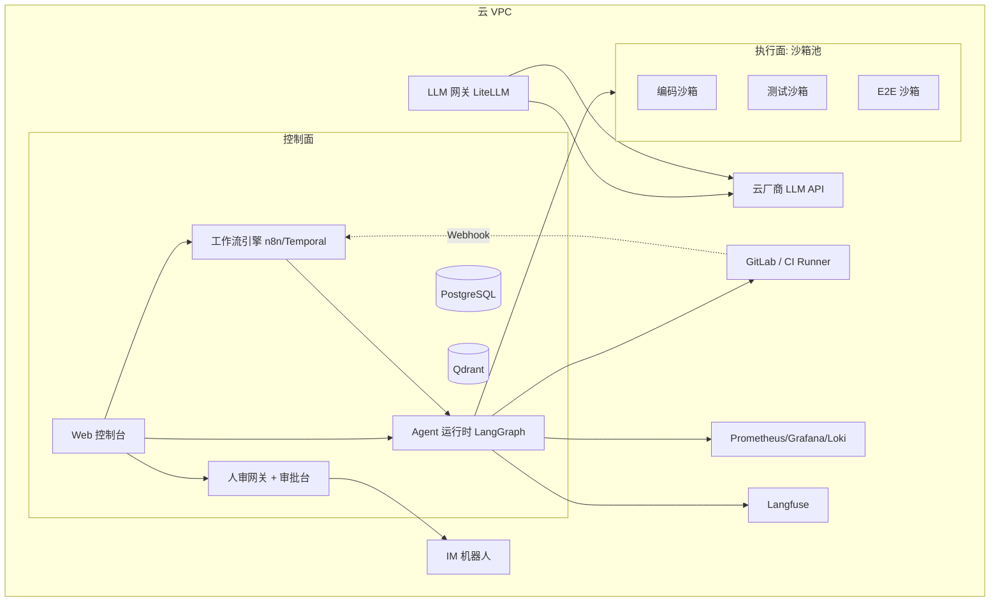

# 04 · 技术选型与组件清单

> 策略：**组装为主**。重量级能力全部采用成熟组件，自研只保留"编排层 + 人审网关 + 集成胶水"——这是平台差异化所在，也是可控性要求最高的部分。

## 1. 组件选型总表

| 能力 | 选型 | 为什么 | 替代方案 | 备注 |
|---|---|---|---|---|
| 工作流引擎（MVP） | **n8n** 或 **Windmill** | 可视化、Webhook 丰富、Agent 节点现成，两周可跑通演示流 | Activepieces | 只承载编排与人审暂停，不写业务逻辑 |
| 工作流引擎（演进） | **Temporal** | 持久化执行、原生 Signal（人审信号）、长时间运行（编码几小时不丢状态） | Dagster | 流程 ≥50 步或需严格可恢复时迁移 |
| Agent 框架 | **LangGraph** | 状态图建模、checkpoint 持久化、`interrupt` 原生支持人审挂起，与 Temporal 有成熟集成模式 | Dify、自研 | 各域 Agent 统一用一套运行时 |
| 编码 Agent | **Claude Code SDK（无头模式）/ Aider** | 支持脚本化集成进 CI/流水线、Git 工作流成熟、与 MR 流程契合 | OpenHands、Qwen-Coder | 跑在沙箱容器内，经 LLM 网关可换模型 |
| LLM 网关 | **LiteLLM** | 多供应商统一接入、模型路由、故障降级、成本计量 | OneAPI | 避免供应商锁定 |
| 知识库/RAG | **RAGFlow + Qdrant** | 文档解析/分块/检索开箱即用，支持混合检索 | LangChain 自拼 | 代码库索引可另用专门工具补充 |
| 可观测/评估 | **Langfuse** | Trace/Eval/成本一体，Agent 级观测 | 自建 | 所有 Agent 调用强制上报 |
| 审批网关 | **自研轻量服务** | 平台差异化核心，逻辑简单（审批状态机 + 通知），必须完全可控 | 通用 BPM/OA | PostgreSQL + Web 审批台 + IM 卡片 |
| 执行沙箱 | **E2B** 或自建 Docker 沙箱池 | 隔离执行不受信代码、即用即毁 | Firecracker 微VM | 云上自建用 Docker + egress 白名单即可 |
| E2E 测试 | **Playwright + MCP** | 测试 Agent 驱动真实浏览器，失败自动截图/录屏 | Selenium | 与 pytest 单测互补 |
| 监控告警 | 复用现有 **Prometheus/Grafana/Loki** 或云监控 | 不重复建设 | 云厂商监控 | 运维 Agent 只查询不替代 |
| IM | **飞书/企微机器人 + 交互卡片** | 人审高频入口，审批卡片推送到手机 | 钉钉 | 与审批网关强集成 |
| 数据 | **PostgreSQL + Qdrant + S3 + Redis Streams/NATS** | 稳、托管成熟、云上有托管版 | MySQL/Milvus | 事件流做组件间解耦 |
| 身份与凭证 | 云厂商 SSO/IdP + **短期 STS** | Agent 按任务申请最小权限临时凭证 | Vault | 密钥不落沙箱 |

### 参考实践

- 长时运行的多步骤 Agent 编排（Temporal/Dagster/LangGraph 模式对比）：[Orchestrating Multi-Step Agents: Temporal/Dagster/LangGraph Patterns for Long-Running Work](https://www.kinde.com/learn/ai-for-software-engineering/ai-devops/orchestrating-multi-step-agents-temporal-dagster-langgraph-patterns-for-long-running-work/)；Temporal + LangGraph 集成示例：[temporal-langgraph-poc](https://github.com/domainio/temporal-langgraph-poc)。
- 编码 Agent 接入 CI/CD 流水线：[How to integrate Claude Code SDK into CI/CD pipelines](https://skywork.ai/blog/how-to-integrate-claude-code-sdk-into-ci-cd-pipelines/)。
- Agent 权限与人工许可（"Agent 何时需要授权"）的治理思路：[When Agents Need Permission](https://current.tinyfish.ai/issue/latest/foundations/article/6401/when-agents-need-permission)。

## 2. 云上部署拓扑（参考）



要点：

- **控制面与执行面分离**：Agent 只能进沙箱池，沙箱 egress 白名单（GitLab、包仓库、LLM 网关），无法直连生产；
- 全部组件优先选云托管版（托管 PG/Redis、托管 K8s 或 Serverless 容器），小团队不养基础设施；
- GitLab 与 CI/CD 保留在现有体系，平台通过 API + Webhook 集成，GitLab Runner 可复用为部分沙箱宿主。

## 3. 成本模型（<20 人团队参考）

| 成本项 | 估算逻辑 | 量级参考 |
|---|---|---|
| LLM 推理 | 最大变量。分层策略：方案/审查/编码用强模型，摘要/分类/琐碎步骤用便宜模型；网关统一计量、按项目分账 | 数百～数千元/月（与任务量强相关，设预算告警） |
| 云资源 | 控制面 + 沙箱池按需弹性（沙箱即用即毁） | 千元级/月 |
| 开源组件 | 全部免费，云托管版有基础费用 | 低 |
| 人力 | 1～2 名平台工程师（兼职即可启动） | 主要隐性成本 |

成本控制三板斧：**模型分层路由**（强模型只用在刀刃上）、**预算告警**（按流程/项目设额度，超限熔断降级）、**缓存与去重**（相同检索/相似审查结果复用）。

## 4. 自研 vs 组装的边界

```
自研（保持薄、无状态）              组装（成熟组件，不魔改）
─────────────────────              ─────────────────────
· SOP DSL 与流程状态机（薄层）        · 工作流引擎（n8n→Temporal）
· 人审网关（审批状态机+卡片+回流）     · Agent 框架（LangGraph）
· 任务中心与看板                      · LLM 网关（LiteLLM）
· 度量面板                            · 知识库（RAGFlow+Qdrant）
· 集成胶水（GitLab/CI/IM 适配器）     · 沙箱（E2B/Docker）
                                      · 可观测（Langfuse）
                                      · 监控/CI/CD（现有体系）
```

**边界原则**：自研层只做"连接、审批、度量"三类逻辑；任何需要长时间演进、有成熟开源的能力（引擎、模型、存储、监控）一律组装。若某开源组件与需求冲突，优先改流程适配组件，而不是魔改组件。

## 5. 关键接口清单

| 接口 | 方向 | 用途 |
|---|---|---|
| GitLab Webhook → 平台 | 入 | Issue/MR/CI 事件驱动流程推进 |
| GitLab API（平台 →） | 出 | 建 Issue/MR、写评论、查 diff |
| CI/CD 触发与结果回读 | 双向 | 构建/测试/发布编排 |
| LLM 网关 API | 双向 | 模型路由与计量 |
| IM 卡片回调 | 双向 | 审批请求与决策回写 |
| 监控查询 API | 出 | 告警诊断取数 |
